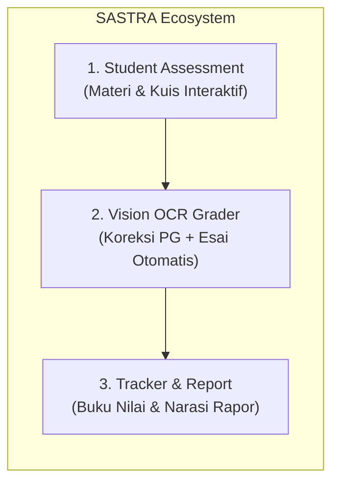
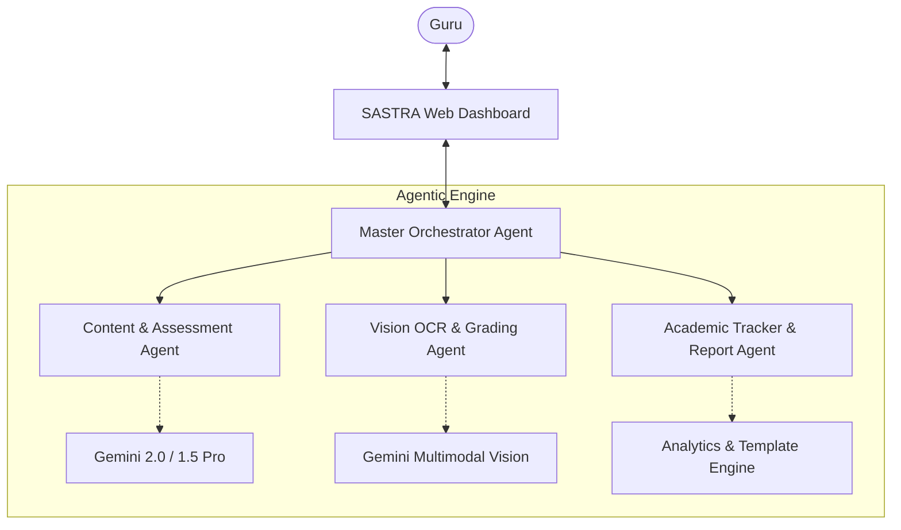

# 🎓 SASTRA: Student Assessment, Tracker, and Report Assistance
> *Staf Asisten Guru Berbasis Agentic AI untuk Mewujudkan Pembelajaran Mendalam (Deep Learning)*  
> *Sesuai Standar Kurikulum & Asesmen Permendikdasmen No. 13 Tahun 2025*

---

## 📌 Latar Belakang & Pernyataan Masalah
Tugas esensial seorang guru adalah menuntun, mendidik, dan menginspirasi generasi masa depan. Namun, realitas di lapangan menunjukkan guru terbebani oleh tumpukan beban administratif:
1. Menghabiskan waktu berjam-jam merancang materi pembelajaran dan kuis interaktif yang kontekstual.
2. Mengoreksi puluhan hingga ratusan lembar jawaban siswa (pilihan ganda maupun esai tulisan tangan) secara manual yang melelahkan dan rentan inkonsistensi.
3. Menyusun narasi capaian belajar rapor semester satu per satu untuk setiap siswa di setiap mata pelajaran.

**SASTRA** hadir sebagai asisten staf otonom bagi guru untuk mengambil alih pekerjaan administratif berulang, sehingga guru dapat kembali fokus mengajar dengan hati.

---

## 🚀 3 Fitur Utama

### 1. Interactive Assessment & Content Generator
* **Input Guru:** Topik bahasan, mata pelajaran, fase/jenjang kelas, dan alokasi waktu.
* **Pendekatan *Deep Learning* (Permendikdasmen 13/2025):** Materi disusun secara *Mindful, Meaningful, & Joyful* (memicu rasa ingin tahu, koneksi kontekstual, bukan sekadar hafalan).
* **Output:**
  * Modul materi ringkas & pertanyaan pemantik (*inquiry-based*).
  * Paket kuis interaktif campuran (Pilihan Ganda + Esai penalaran kritis).
  * Lembar Kerja Peserta Didik (LKPD) yang siap dicetak atau dibagikan.

### 2. Multi-Modal Vision Grader (Koreksi Lembar Jawaban Siswa)
* **Input Guru:** Foto / scan lembar jawaban siswa (JPG/PNG/PDF), baik tulisan tangan maupun ketikan, beserta kunci jawaban & rubrik penilaian.
* **Proses Evaluasi:**
  * **Pilihan Ganda:** Pengenalan optik instan (Vision OCR) dan pencocokan kunci jawaban.
  * **Esai / Jawaban Terbuka:** Pemahaman semantik alur logika berpikir siswa dengan rubrik analitik, bukan sekadar *exact keyword matching*.
* **Output:**
  * Rekap skor terperinci per nomor soal.
  * Umpan balik (*constructive feedback*) personal untuk siswa.
  * *Human-in-the-loop*: Guru dapat memeriksa dan merevisi nilai secara fleksibel.

### 3. Student Tracker & Semester Report Assistant
* **Pelacak Perkembangan (*Tracker*):** Akumulasi nilai tugas, kuis, dan ujian formatif/sumatif secara berkala ke dalam Buku Nilai digital.
* **Analisis Kompetensi:** Deteksi materi mana yang telah dikuasai dengan baik oleh siswa dan materi mana yang membutuhkan pendampingan/remedial.
* **Otomasi Narasi Rapor:** Menghasilkan deskripsi capaian kompetensi siswa yang unik, kaya konteks, dan empatik sesuai format pelaporan hasil belajar Permendikdasmen No. 13 Tahun 2025.
* **Ekspor:** File cetak siap guna (Excel / Word / PDF).

---

## 🤖 Arsitektur Multi-Agent

| Agent | Peran & Tanggung Jawab |
| :--- | :--- |
| **Master Orchestrator** | Mengelola sesi kerja guru, meneruskan konteks antar fitur, dan memastikan keamanan data siswa. |
| **Content & Assessment Agent** | Merancang materi, pertanyaan pemantik, serta paket kuis PG & esai berbasis prinsip *Deep Learning*. |
| **Vision OCR & Grading Agent** | Mengekstraksi tulisan tangan siswa dari gambar/PDF, mengevaluasi jawaban, dan merumuskan feedback personal. |
| **Academic Tracker & Report Agent** | Mengagregasi riwayat nilai, menganalisis capaian per tujuan pembelajaran, dan menghasilkan draf narasi rapor akhir semester. |

---

## 🛠️ Rencana Teknologi (Tech Stack)
* **Frontend:** React + Vite, Tailwind CSS / Vanilla CSS modern, Lucide Icons, Chart.js / Recharts.
* **Backend:** Python FastAPI (asynchronous, performa tinggi, native AI tooling).
* **AI Model:** Google Gemini 2.0 Flash / Gemini 1.5 Pro (Multimodal Vision API & Context Caching).
* **Database & Dokumen:** SQLite / PostgreSQL lokal, PDFKit / python-docx / openpyxl untuk ekspor laporan.
